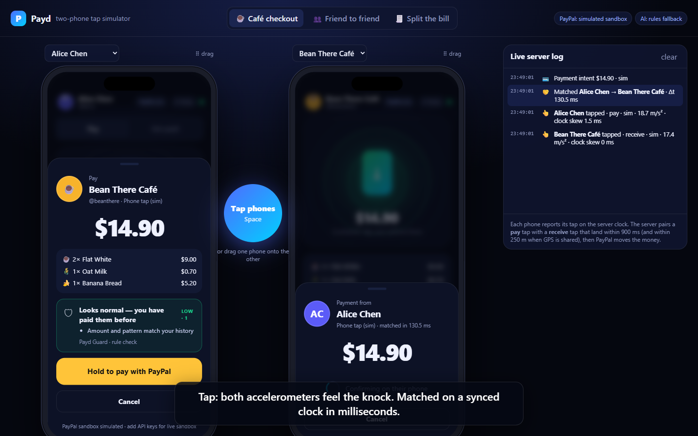
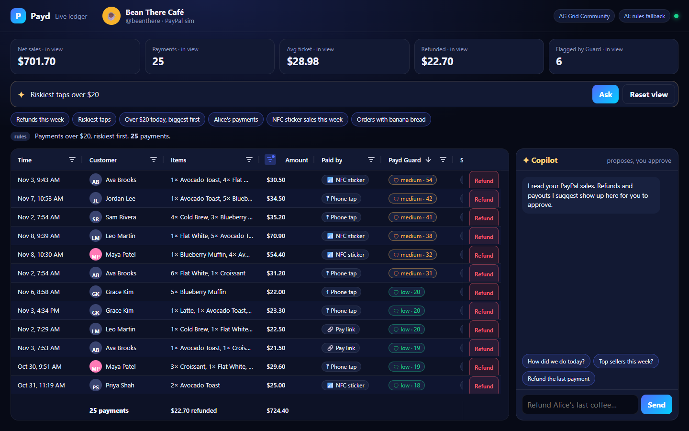
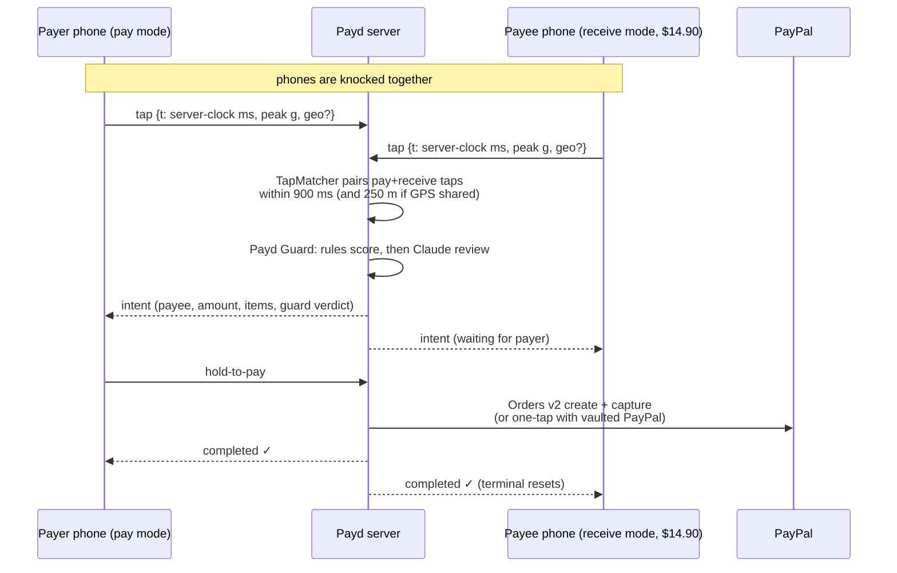

# Payd: tap phones, get paid

**Payd turns any two phones into a PayPal payment terminal.** Knock an iPhone against an Android phone (or any two phones) and money moves through PayPal. It works person to person or at a business counter, with no card reader, no NFC hardware access and no app store install. The web app runs on both iOS and Android.

> Built for the [PayPal AI Hackathon 2026](https://paypalaihackathon.devpost.com/). It uses **PayPal Orders v2 + Vault + Refunds + Payouts** (sandbox) for the money and **Claude** for the intelligence.





---

## Why

Apple Pay and Google Pay are great until you need to receive money. Neither lets a person or a small business accept a contactless payment from an arbitrary phone without hardware or a merchant contract. Phone-to-phone NFC is closed off on iOS and missing from the web on both platforms. As a result, market stalls, food trucks, tutors, babysitters and friends splitting a dinner bill still read out emails or show QR codes.

Payd makes **receiving as easy as paying**. Anyone with PayPal can be the terminal.

## How the tap works (iOS and Android)



1. **Bump detection**: each phone's accelerometer looks for a sharp, high-jerk impulse that stands out from the baseline. Continuous shaking is ignored (`public/js/sensor.js`).
2. **Clock sync**: every phone keeps an NTP-style offset to the server clock, so both taps are compared on one timeline (`public/js/net.js`).
3. **Matching**: the server pairs a `pay` tap with a `receive` tap that land within 900 ms, picks the closest one, rejects pairs that are too far apart when GPS is shared, and flags ambiguous matches (two phones tapping at the same moment nearby) for the fraud guard (`server/tapmatch.js`, unit-tested).
4. **Fallbacks for every phone**:
   - **NFC sticker**: a business programs a cheap NFC sticker with its Payd link (Web NFC on Android, from the Me tab). Any iPhone XS+ or Android opens it natively and pays whatever is on the terminal right now.
   - **QR code** on the terminal screen.
   - **Pay link** for remote payments.

## Features

| | |
|---|---|
| **Tap to pay / tap to get paid** | P2P: "Get paid" → enter amount → tap. Payer sees the request, holds to pay. "Send a set amount" works the other way round. |
| **Business terminal** | Catalog grid, cart, custom amounts, live QR, NFC sticker. After each sale the terminal resets on its own. Sales tab with refunds. |
| **✦ Voice/Text checkout (Claude)** | Barista says *"two flat whites, one with oat, and a banana bread"* → Claude turns it into a structured cart from the menu (synonyms, add-ons, off-menu items flagged) → **Charge**. |
| **✦ Snap & Split (Claude vision)** | Photo the restaurant bill → Claude extracts line items, tax, tip, total → choose how many people → each friend just **taps their phone on yours** to pay their share. Live progress. |
| **✦ Payd Guard (Claude)** | Every tap is reviewed before money moves. Instant rule signals (amount vs. your history, tap limit, first-time payee, tap velocity, ambiguous pairing, GPS distance) feed into a Claude review. Claude explains the risk to the payer in plain language. High-risk taps need an explicit acknowledgement, and `block` is enforced on the server. |
| **✦ Merchant Copilot (Claude agent)** | "How did we do today?", "Top sellers this week?", "Ring up 2 lattes and a croissant", "Refund Alice, her coffee was cold", "Pay supplier@beans.co $120". Claude uses tools over the merchant's PayPal transactions. **Money-moving tools only *propose* actions.** The merchant approves each refund or payout in the UI (human in the loop). |
| **One-touch after first use** | First payment is approved with PayPal Smart Buttons and saves the PayPal wallet with **PayPal Vault** (`store_in_vault: ON_SUCCESS`). Later taps charge the vaulted wallet instantly, Apple-Pay style. |
| **Live ledger (AG Grid)** | `/dashboard`: the merchant's back office, built on **AG Grid Community**. Every PayPal transaction sits in one grid with customer, items, amount, payment method, **Payd Guard score** and PayPal capture ID. New taps **stream in live** over the WebSocket and flash into the grid. Each row has a **Refund** button (full or partial, through PayPal), and KPIs plus a pinned totals row recalculate for whatever is filtered. |
| **✦ Ask your ledger (Claude × AG Grid)** | Type *"refunds over $10 this week"* or *"riskiest taps over $20"*. Claude turns the sentence into a validated AG Grid filter model and sort state, and the grid reshapes on the spot. The Copilot sits beside the grid, and the row behind each refund it proposes is highlighted. |
| **Two-phone simulator** | `/sim` runs two live phones side by side. Drag one onto the other (or press Space) and watch the server log: taps, clock skew, match Δt, Guard verdict, every PayPal API call and every Claude call. |

## PayPal integration

All in `server/paypal.js`:

| API | Used for |
|---|---|
| `POST /v1/oauth2/token` | Client-credentials auth (cached) |
| `POST /v2/checkout/orders` | Create the order for a tap: `payee.email_address` = the person or business being paid, line items + breakdown for terminal sales, `payment_source.paypal.attributes.vault` to save the wallet, `PayPal-Request-Id` idempotency per tap |
| `POST /v2/checkout/orders/{id}/capture` | Capture after the payer approves |
| `POST /v2/checkout/orders` with `payment_source.paypal.vault_id` | **One-tap repeat payments** with the vaulted wallet |
| `POST /v2/payments/captures/{id}/refund` | Full/partial refunds from Sales or Copilot |
| `POST /v1/payments/payouts` | Merchant payouts (e.g. paying a supplier) proposed by Copilot |
| PayPal JS SDK (Smart Payment Buttons) | First-time approval on the payer's phone |

With no PayPal keys, Payd runs a **faithful mock**. It keeps the same call shapes and the same order/capture/refund lifecycle with simulated latency, so the whole demo works offline. Add sandbox keys and the same code talks to `api-m.sandbox.paypal.com`.

## AI integration (Claude)

All in `server/ai.js`, using the official `@anthropic-ai/sdk`:

- **Structured outputs** (`output_config.format: json_schema`) for checkout carts, receipt extraction (vision) and Guard verdicts. The responses are typed and validated, with no fragile parsing.
- **Grid control**: "Ask your ledger" returns a JSON spec (column, op, value) that `server/gridquery.js` validates and converts into an AG Grid `filterModel` and column sort state.
- **Tool runner** (`client.beta.messages.toolRunner`) for the Copilot agent with five tools: `sales_summary`, `list_transactions`, `ring_up`, `propose_refund`, `propose_payout`.
- **Server-side refusal fallbacks** (`fallbacks: "default"`) so a declined request is retried on Anthropic's recommended fallback model inside the same call.
- Default model `claude-opus-5-5` (override with `PAYD_MODEL`), low effort for the latency-sensitive Guard and checkout calls.
- **Every AI feature has a deterministic fallback** (`server/heuristics.js`). The app never blocks on the model: Guard shows the rule verdict instantly and Claude refines it a moment later.

## Run it

Requires Node 20+.

```bash
git clone <this repo> payd && cd payd
npm install
npm start
```

- App: http://localhost:3000. Pick a profile (Alice, Ben, Maya or Bean There Café).
- **Two-phone simulator: http://localhost:3000/sim**.
- **Merchant live ledger: http://localhost:3000/dashboard?as=cafe**. Keep it open next to the simulator and watch taps land in the grid. Choose a scenario (Café checkout, Friend to friend, Split the bill) and drag one phone onto the other.
- Desktop without a motion sensor: press **T** (or click the tap area) in a single-phone window.

### Turn on the real services

Copy `.env.example` to `.env`:

```bash
# PayPal sandbox (developer.paypal.com → Apps & Credentials → Sandbox)
PAYPAL_CLIENT_ID=...
PAYPAL_CLIENT_SECRET=...
# Optional: sandbox accounts that receive money for the seeded demo users
PAYD_SEED_CAFE_EMAIL=sb-cafe@business.example.com
PAYD_SEED_BEN_EMAIL=sb-ben@personal.example.com

# Claude
ANTHROPIC_API_KEY=...
```

For one-touch vaulted payments, enable **"Save payment methods"** on the sandbox app. Without it, Payd retries without vault and every tap uses the PayPal approval popup. Any user can set their own sandbox email in **Me → PayPal**. If a payee has no email, funds settle to the Payd platform sandbox account.

### On real phones

Motion sensors and Web NFC need **HTTPS**. The quickest options:

- Deploy to Render with the included `render.yaml` (New → Blueprint → this repo). It runs as one always-on Node process, so both phones share the same tap matcher. On serverless hosts (e.g. Vercel), connections spread across instances and taps from two phones may never meet. Or
- Tunnel your laptop with `npx cloudflared tunnel --url http://localhost:3000` (or ngrok).

Open the HTTPS URL on two phones, pick two profiles, tap **Enable tap to pay** (iOS asks for motion permission), then knock the phones together.

### Tests

```bash
npm test
```

There are 26 tests: tap matching (time window, geo gate, ambiguity, expiry), order parsing, Guard rules, money math, natural-language → AG Grid filter conversion, the Claude integration against a fake transport (request shape, structured outputs, refusal fallbacks, the copilot tool loop with proposal-only refunds), and a full **end-to-end** run that boots the server, connects two WebSocket "phones", taps, pays, refunds, pays through an NFC sticker link and collects a split.

## Project layout

```
server/
  index.js       Express + WebSocket server, payment intents, REST API
  tapmatch.js    Tap pairing engine (time window, geo gate, ambiguity)
  paypal.js      PayPal REST client (Orders v2, Vault, Refunds, Payouts) + mock
  ai.js          Claude features (checkout, receipts, Guard, Copilot agent, ledger queries)
  gridquery.js   Natural language -> AG Grid filter/sort state (validation + rule fallback)
  heuristics.js  Deterministic fallbacks for every AI feature
  store.js       JSON-file store with seeded demo data
public/
  index.html     PWA shell (installable on iOS/Android home screen)
  js/app.js      Phone UI: tap stage, pay sheet, terminal, split, copilot
  js/sensor.js   Accelerometer bump detection
  js/net.js      REST + realtime socket with clock sync
  sim.html       Two-phone simulator with live server log
  dashboard.html Merchant live ledger (AG Grid) + Ask your ledger + Copilot
test/            node:test suites (unit + e2e)
```

## Security notes and limits (hackathon scope)

- Profiles are demo identities with no authentication. A production build would put PayPal Log In / passkeys in front of every profile and sign WebSocket sessions.
- Amounts are validated server side (≤ $10,000 per tap), only the payer can pay an intent, only the payee can refund, and Guard `block` verdicts are enforced on the server.
- Bump matching is probabilistic. Two pairs tapping in the same room at the same instant are flagged as ambiguous, and the payer always sees who they are paying before confirming.
- Real phone-to-phone NFC (HCE) would need native apps. Payd deliberately uses motion plus server matching so it works on the open web on both platforms today.

## License

MIT, see [LICENSE](LICENSE).
